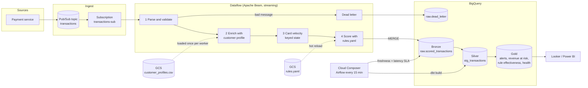
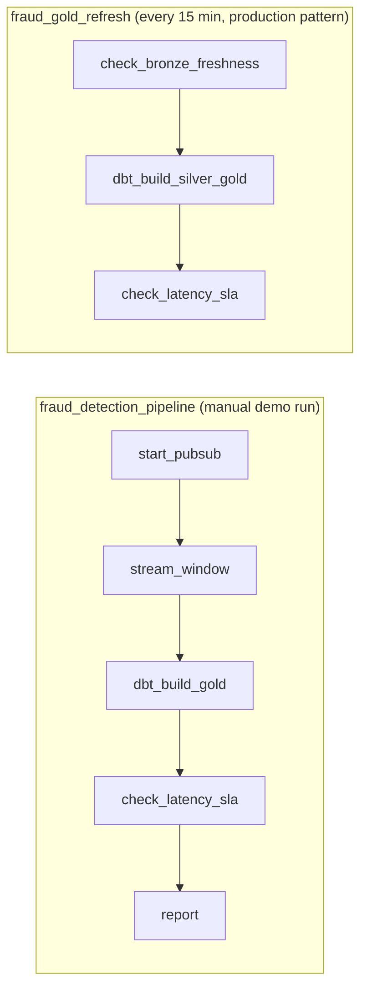

# System design: real-time fraud detection pipeline

This page explains how the system is put together, one step at a time. Follow it in order and you can redraw the design on a whiteboard.

## 1. Problem and requirements

A travel company takes card payments for hotels, flights, car rentals and cruises. Fraud used to be checked in batches every few hours, so a stolen card had already been used by the time it was flagged.

| Type | Requirement | How the design meets it |
|---|---|---|
| Functional | Score every payment for fraud as it arrives | Streaming Beam job, rules engine |
| Functional | Publish "revenue at risk" by category and day for BI | dbt Gold tables in BigQuery |
| Functional | Analysts can change rules without a deploy | `rules.yaml` hot reload every 15 s |
| Latency | Payment to scored row in under 1 second (p95) | Streaming, in-memory state, micro-batch MERGE |
| Correctness | A redelivered message must never be counted twice | MERGE on `transaction_id` (idempotent writes) |
| Reliability | A malformed message must not crash the job | Dead-letter output |
| Scale | 3x traffic with no redesign | Dataflow autoscaling, stateless steps keyed by card |

## 2. Architecture (production, GCP)



## 3. Local stand-ins

The code is the same in both columns; only flags and connection settings change.

| Production | Local in this repo |
|---|---|
| Pub/Sub | Official Pub/Sub emulator in Docker (`docker-compose.yml`) |
| Dataflow | Beam `BundleBasedDirectRunner` |
| BigQuery | DuckDB file (`pipeline/sinks.py` has both sinks) |
| Cloud Composer | Airflow 3.2 standalone (`airflow/dags/`) |
| dbt on BigQuery | dbt on DuckDB (`DBT_TARGET` switches the profile) |

## 4. One payment, step by step

**Step 1. The payment is published.** `producer/generate_transactions.py` plays the payment service. Each payment is one JSON message on the `transactions` topic. It also sends known fraud patterns (card testing, bursts, foreign IP), a few duplicates and one broken message, so every branch of the pipeline gets exercised.

**Step 2. Pub/Sub buffers it.** Pub/Sub separates the producer from the consumer. If the pipeline slows down, messages wait in the subscription instead of being lost. Pub/Sub delivers at least once, so the same payment can arrive twice. Step 7 deals with that.

**Step 3. Parse and validate** (`ParseAndValidate`). The message is decoded and checked for required fields (ID, card, amount, timestamp). A message that fails goes to a tagged side output, the **dead letter**, with the error and the raw payload. The job keeps running and the bad message can be inspected and replayed later.

**Step 4. Enrich** (`EnrichWithProfile`). The customer's home country, usual spend and known devices are added. The profile file is loaded once per worker in `setup()`, so there is no database call per payment.

**Step 5. Card velocity** (`CardVelocity`). The stream is keyed by card number. Beam keeps a small piece of **state** per card: the timestamps of its recent payments. The step counts payments in the last 60 seconds. Keeping this in the stream is what makes it fast; querying the warehouse for every payment would not be.

**Step 6. Score** (`Score`). Each rule that matches adds points; 50 or more is an alert. The reasons are stored with the row.

| Rule | Points |
|---|---|
| Amount far above the customer's normal spend | +50 |
| More than 5 payments on the card in a minute | +40 |
| IP country differs from home country | +30 |
| Tiny "test" amount (2 dollars or less) | +25 |
| Unknown device and 800 dollars or more | +25 |

The rules live in `config/rules.yaml`. The step re-reads the file when it changes (checked every 15 seconds), so an analyst can switch off a noisy rule without restarting the job.

**Step 7. Write with MERGE** (`WriteToWarehouse`, `pipeline/sinks.py`). Rows are buffered per bundle (up to 500), loaded into a staging table and **merged** into Bronze on `transaction_id`. A duplicate delivery updates the existing row instead of adding a new one, so a replay or redelivery never inflates revenue at risk. This is what makes the write idempotent.

**Step 8. dbt builds Silver and Gold.** `stg_transactions` cleans names and types and works out latency. Gold has:

| Gold table | Answers |
|---|---|
| `fct_fraud_alerts` | Which payments were flagged and why |
| `agg_revenue_at_risk_daily` | Booking value vs flagged value, per category per day |
| `rpt_rule_effectiveness` | How often each rule fires and how often it is right |
| `rpt_pipeline_health` | p50/p95 latency, duplicates absorbed, precision, recall |

dbt tests (unique, not null, every alert has a reason) run in the same `dbt build`.

**Step 9. Airflow keeps it honest.** `fraud_gold_refresh` runs every 15 minutes: it checks Bronze has fresh rows (the stream is alive), rebuilds Silver and Gold, and fails if p95 latency breaks the SLA.

## 5. Orchestration



In production the Dataflow job runs all the time, outside Airflow. Airflow only schedules the batch side (dbt and checks). On a laptop, `stream_window` starts the stream, runs it for N seconds and drains it, so a demo run has a start and an end.

## 6. Design decisions and trade-offs

| Decision | Why | Trade-off |
|---|---|---|
| Rules engine, not an ML model | Explainable reasons per alert, analysts can tune it, no training data needed | Lower recall (about 55 to 65%) on the first payments of a burst |
| Keyed state for velocity | Sub-second answers, no warehouse lookups | State is per worker; needs keying by card to stay correct |
| MERGE instead of INSERT | Exactly-once results on top of at-least-once delivery | MERGE costs more than append; mitigated by micro-batching |
| Dead letter instead of failing | One bad message never stops the stream | Someone must watch the dead-letter table |
| Profile file loaded once per worker | No per-event lookups | Profiles are as fresh as the last file refresh |
| Gold rebuilt every 15 minutes | Dashboards stay cheap and simple | Gold lags the stream by up to 15 minutes; alerts themselves are real time |

## 7. Failure handling

| What goes wrong | What happens |
|---|---|
| Malformed JSON or missing field | Row goes to `raw.dead_letter`; stream continues |
| Pub/Sub redelivers a message | MERGE updates the same row; counts stay correct |
| Pipeline is down | Messages wait in the subscription (7-day retention); `check_bronze_freshness` fails and alerts |
| Latency degrades | `check_latency_sla` fails the run |
| Bad rule change | Revert `rules.yaml`; the job picks it up in 15 s |

## 8. Scaling

- Dataflow autoscales workers on backlog. Every step is either stateless or keyed by card, so work spreads across workers with no shared lock.
- The local test at 3x load (about 60 events per second) kept p95 latency at 0.61 s with no code change.
- BigQuery Bronze is partitioned by day and clustered by card and category, so Gold queries scan only recent partitions.

## 9. Whiteboard version (five boxes)

```
Payments ─► Pub/Sub ─► Beam on Dataflow ─────────────► BigQuery Bronze ─► dbt Silver/Gold ─► BI
                       parse → enrich → velocity        (MERGE, idempotent)   (Composer, 15 min)
                       → score (rules.yaml hot reload)
                       bad messages → dead letter
```
